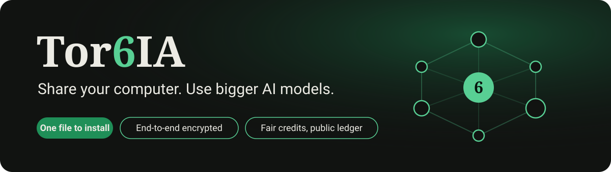
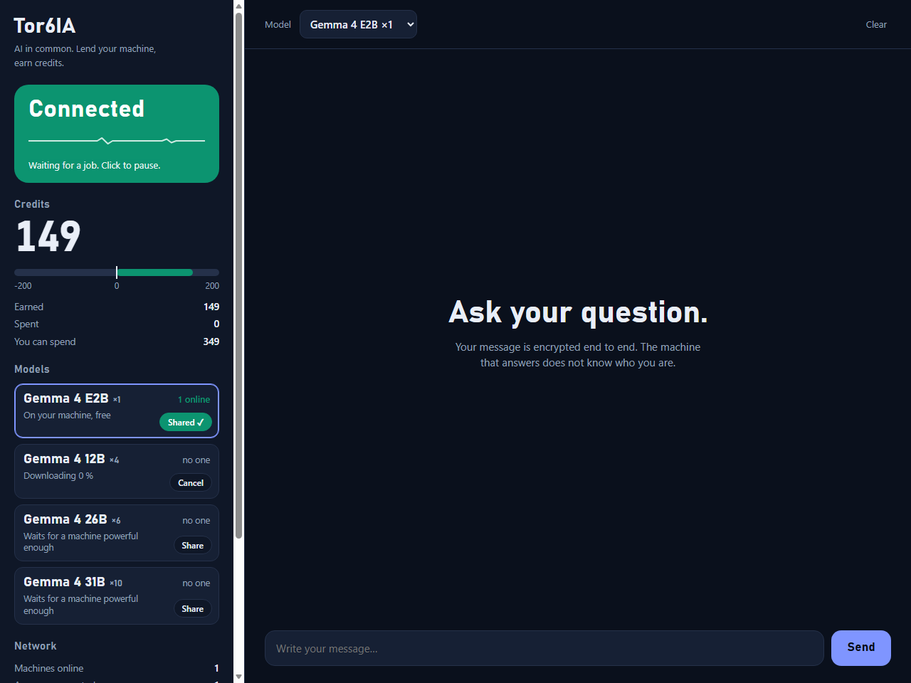
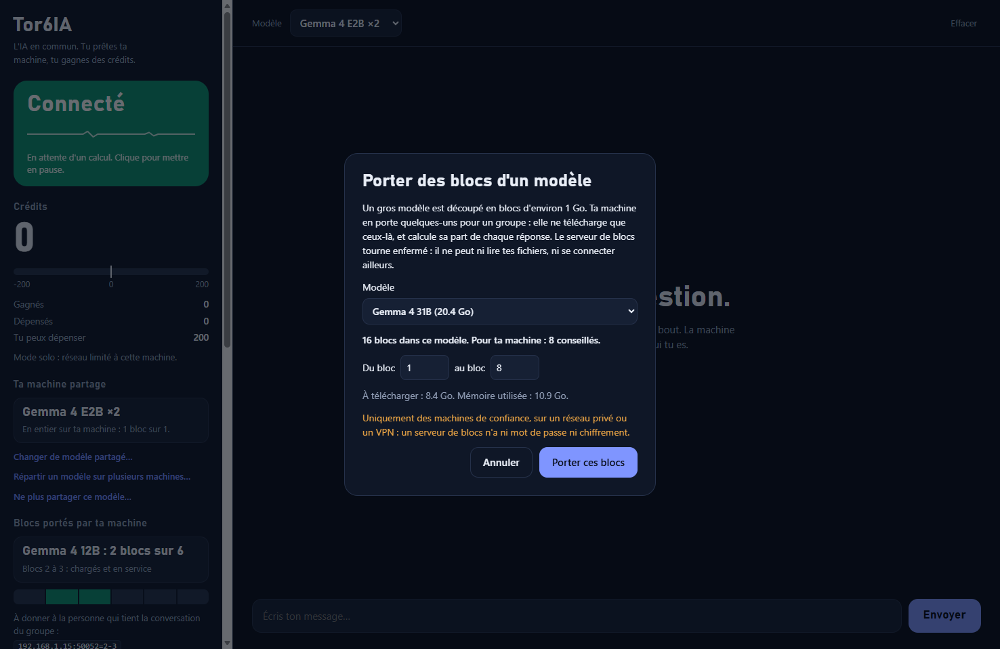
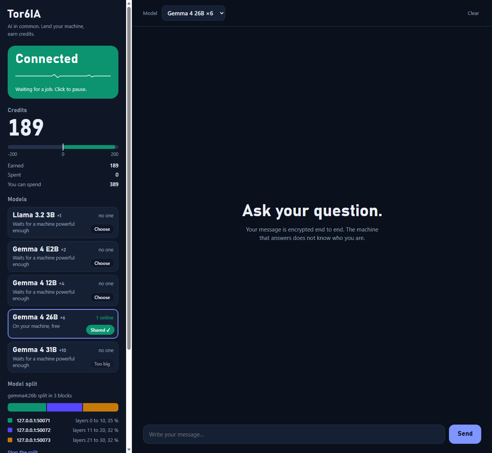
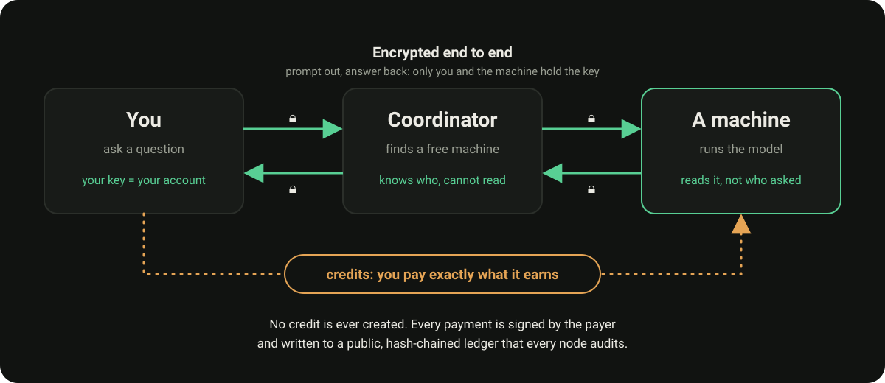

<p align="center"></p>

# Tor6IA : partage ta machine, utilise de plus gros modèles d'IA

<p align="center">
  <a href="https://github.com/tomDeprez/Tor6IA/actions/workflows/ci.yml"></a>
  <a href="https://github.com/tomDeprez/Tor6IA/releases/latest"></a>
  <a href="https://github.com/tomDeprez/Tor6IA/releases"></a>
  <a href="https://github.com/tomDeprez/Tor6IA/stargazers"></a>
  <a href="LICENSE"></a>
</p>

**Tor6IA est un réseau pair à pair pour faire tourner des modèles d'IA ouverts.** Ta machine calcule pour les autres et gagne des crédits. Tu dépenses ces crédits pour utiliser les modèles des autres machines, y compris ceux trop gros pour la tienne.

C'est simple : un fichier, aucun compte, rien à configurer. [English](README.md)

<p align="center">
  <a href="https://github.com/tomDeprez/Tor6IA/releases/latest/download/tor6ia-windows-amd64.exe"></a>
  &nbsp;
  <a href="#linux-et-macos"></a>
</p>

<p align="center"></p>

## Trois étapes

| | |
|---|---|
| **1. Installe** | Double-clique sur un fichier sous Windows, ou colle une commande sous Linux et macOS. Ollama et le modèle sont installés pour toi. |
| **2. Ta machine partage** | Le gros bouton passe au vert : tu es connecté. Quand quelqu'un utilise ta machine il passe au bleu, et tu gagnes des crédits. |
| **3. Utilise n'importe quel modèle** | Discute dans l'interface, ou branche n'importe quel client OpenAI sur `http://localhost:7606/v1`. Tes crédits paient des modèles plus gros que ta machine. |

## Pourquoi

- **Équitable.** Aucun crédit n'est jamais créé. Tu gagnes exactement ce qu'une autre personne paie pour le calcul fait sur ta machine.
- **Vérifiable.** Le registre des crédits est public, chaîné et signé, comme une blockchain. Chaque nœud le vérifie tout seul.
- **Privé.** Questions et réponses sont chiffrées de bout en bout. Le coordinateur sait qui demande mais ne peut pas lire. La machine qui répond lit le message mais ne sait pas qui l'envoie.
- **Zéro compte.** Ton identité est une clé créée sur ta machine. Pas d'e-mail, pas de mot de passe.
- **Compatible avec tes outils.** API compatible OpenAI sur `http://localhost:7606/v1`.

## Installer

### Windows

**[Télécharge tor6ia-windows-amd64.exe](https://github.com/tomDeprez/Tor6IA/releases/latest/download/tor6ia-windows-amd64.exe)** et double-clique dessus.

Il s'installe tout seul, installe Ollama, choisit le modèle adapté à ta machine, le télécharge et ouvre l'interface. Sans droits administrateur.

Windows affiche « Windows a protégé votre ordinateur » car le fichier n'est pas encore signé : clique sur **Informations complémentaires**, puis **Exécuter quand même**. Ou passe par PowerShell, sans avertissement :

```powershell
irm https://raw.githubusercontent.com/tomDeprez/Tor6IA/main/install.ps1 | iex
```

### Linux et macOS

```sh
curl -fsSL https://raw.githubusercontent.com/tomDeprez/Tor6IA/main/install.sh | sh
```

L'interface s'ouvre sur `http://localhost:7606`. Chaque version lance cette commande sur des machines Linux et macOS vierges et pose une question au modèle.

Désinstaller : bouton **Désinstaller Tor6IA…** en bas de l'interface.

## L'interface

Le gros bouton en haut dit ce que fait ta machine. Un clic met le partage en pause ou le reprend.

| Couleur | État |
|---|---|
| Vert | Connecté, en attente d'un calcul |
| Bleu | Calcul en cours pour quelqu'un : tu gagnes des crédits |
| Orange | Installation ou connexion en cours |
| Gris | En pause, ou coordinateur injoignable |
| Rouge | Problème, ou alerte : le registre a échoué à l'audit |

La liste des modèles montre combien de machines proposent chacun, son prix, et combien de tokens ton solde permet. Une machine partage un seul modèle à la fois. **Choisir** passe à un autre. Le bouton demande toujours confirmation et dit ce que ça implique : taille du téléchargement, vitesse sur ton matériel, ce que tu gagnes, et s'il faut supprimer l'ancien modèle.

**Partagé ✓** arrête de partager un modèle, et peut supprimer ses fichiers pour libérer le disque. Un téléchargement en cours s'annule. **Désinstaller Tor6IA…**, en bas, retire tout : la machine quitte le réseau, les modèles partagés et le programme sont supprimés. Quand une machine se met en pause ou s'en va, les autres voient aussitôt qu'il manque une machine pour ses modèles.

**Mises à jour.** Quand une nouvelle version est publiée, le programme montre ce qui change et se met à jour en un clic. Une version compilée depuis le code ne demande jamais.

## Les modèles

| Modèle | Prix | Rapide sur | Lent sur |
|---|---|---|---|
| Llama 3.2 3B | ×1 | n'importe quel PC avec 6 Go de mémoire | |
| Gemma 4 E2B | ×2 | n'importe quel PC avec 10 Go de mémoire | |
| Gemma 4 12B | ×4 | carte graphique 10 Go | processeur avec 14 Go de mémoire |
| Gemma 4 26B | ×6 | carte graphique 22 Go | processeur avec 31 Go de mémoire |
| Gemma 4 31B | ×10 | carte graphique 24 Go | processeur avec 33 Go de mémoire |

Gemma 4 26B contient 26 milliards de paramètres et en utilise 4 par token : il répond bien plus vite que sa taille ne le laisse penser.

Un nœud démarre avec le plus gros modèle qu'il fait tourner vite. Une machine ne charge jamais un modèle pour lequel elle n'a pas la mémoire, et le calcul n'utilise que la moitié de ses processeurs : elle reste utilisable. Seules les cartes NVIDIA et les Mac Apple Silicon sont détectés automatiquement.

Un modèle sans machine affiche « en attente d'une machine ». Il devient disponible dès que quelqu'un d'assez équipé le partage.

## Un modèle réparti sur plusieurs machines

Un modèle trop gros pour une machine peut être partagé par un groupe. Le modèle est coupé en blocs de couches ; chaque machine du groupe porte les blocs que sa mémoire permet, et la tienne propose le modèle au réseau et reçoit le paiement.

Un modèle est découpé en blocs d'environ 1 Go, de la même façon sur toutes les machines. Gemma 4 12B a 6 blocs, par exemple.

1. Sur chaque machine du groupe, ouvre Tor6IA et clique sur **Porter des blocs d'un modèle…**. Choisis le modèle : l'interface lit son plan sans le télécharger, dit combien de blocs il a et combien ta machine peut en porter. Choisis les blocs, par exemple 2 à 3. La machine ne télécharge que ces blocs, les charge, et affiche une ligne à donner au groupe, comme `192.168.1.20:50052=2-3#5f1c…`. La fin de la ligne est un secret : qui a la ligne peut faire calculer cette machine, personne d'autre.
2. Sur la machine qui tient la conversation, clique sur **Répartir un modèle sur plusieurs machines…**, choisis le modèle et colle une ligne par machine. Les blocs doivent faire le modèle entier, chaque bloc une seule fois : un groupe avec un trou est refusé, et l'interface dit quels blocs personne ne porte. Cette machine a besoin du fichier entier du modèle.

Le serveur de blocs tourne enfermé : il ne peut ni lire tes fichiers, ni se connecter ailleurs, ni lancer un programme.

<p align="center"></p>

<p align="center"></p>

L'interface affiche alors le découpage : une barre pour le modèle, un segment par bloc, et quelle machine porte quelles couches. Si une machine du groupe s'en va, le modèle n'est plus réparti et l'interface le dit ; ta machine continue à le proposer seule si elle en a la mémoire.

**Entre personnes que tu as choisies.** Ce qui passe entre les machines d'un groupe est chiffré, et une machine n'obéit qu'à qui a sa ligne. Pour un groupe formé à la main, les machines doivent pouvoir se joindre : même réseau, VPN, ou port ouvert.

### Le réseau forme les groupes

Personne n'a de ligne à échanger. Chaque machine dit ce qu'elle fait, et le coordinateur assemble les machines :

1. **Porter des blocs d'un modèle…** sur plusieurs machines. Chacune annonce ses blocs au réseau, et la fenêtre propose les blocs que le moins de machines portent. Une machine derrière une box est jointe par le relais du réseau : elle n'ouvre aucun port.
2. **Tenir les conversations d'un modèle en blocs…** sur une machine qui a la place sur son disque pour le fichier entier du modèle. Elle a besoin de peu de mémoire.
3. Quand chaque bloc a ses porteurs (deux par bloc sur le réseau public, pour que l'un puisse partir) et qu'une machine tient les conversations, le coordinateur donne à cette machine une chaîne, un porteur pour chaque bloc. Elle charge le modèle sur eux et le propose à tous, comme n'importe quel modèle.

La liste des modèles le montre en direct : « En blocs : 4 blocs sur 6 portés », puis « chaîne formée ». Quand une machine de la chaîne part, le coordinateur refait une chaîne avec les porteurs qui restent, et une réponse en cours d'écriture reprend là où elle s'était arrêtée.

Le relais fait passer ce que les machines échangent quand elles ne peuvent pas se joindre directement. Il voit qui parle à qui et combien, jamais quoi : le lien entre deux machines est chiffré de bout en bout. Deux machines du même réseau se parlent directement, sans le relais.

À savoir avant de porter des blocs ou des conversations pour des inconnus :

- Les machines d'une chaîne voient passer les nombres du calcul, pas le texte. La machine qui tient la conversation voit le texte, comme toute machine qui répond.
- Pour l'instant le paiement d'une réponse va à la machine qui tient la conversation. Le partager entre les porteurs, chacun selon ses blocs, est la prochaine étape.
- Le coordinateur donne la ligne d'un porteur à la machine qu'il a choisie pour tenir les conversations. Une ligne permet à cette machine d'utiliser les blocs. Mesuré sur un portable, Gemma 4 12B coupé en deux répond à 3,3 tokens par seconde, et encore 1,9 avec 50 ms de délai réseau dans chaque sens.

## Les crédits

**Aucun crédit n'est créé.** Un paiement déplace des crédits du compte qui demande vers le compte qui calcule. La somme de tous les soldes vaut toujours zéro.

- **Tout le monde part de 0.**
- **Gagner.** Quand une autre personne calcule sur ta machine, tu reçois exactement ce qu'elle paie.
- **Prix.** Un crédit vaut environ un token d'un modèle ×1 : 4 octets de réponse, ou 40 octets de question, multipliés par le prix du modèle. Le coordinateur compte les octets, ton nœud recompte et alerte en cas d'écart.
- **Découvert de départ.** Si tout le monde est à 0, personne ne peut payer la première demande. Une machine qui réussit un calcul de test (le coordinateur en connaît la réponse) peut donc descendre jusqu'à −200. Ce test est limité à une machine par adresse IP toutes les 10 minutes.
- **Gratuit chez soi.** Le modèle que ta machine héberge répond en local, sans crédit et sans réseau.
- **Plafond.** Le coût maximal est bloqué avant le calcul, la réponse s'arrête quand la limite est atteinte.
- **Bascule automatique.** Si la machine qui calcule disparaît avant de répondre, ton nœud en demande une autre. L'essai raté ne coûte rien.

## Impossible de tricher sur les crédits

Le registre est public : `https://<coordinateur>/v1/ledger`. Chaque ligne contient le hachage de la précédente, comme une blockchain.

| Règle | Ce qui la garantit |
|---|---|
| Personne ne prend tes crédits, pas même le coordinateur | Un paiement n'est valide qu'avec la signature de ta clé, pour ce job, ce bénéficiaire et ce plafond |
| Aucun crédit ne sort de nulle part | Le registre ne connaît que des paiements : la somme reste nulle |
| Personne ne dépense plus que son solde et son découvert | Vérifié à chaque ligne |
| Le passé ne peut pas être réécrit | Chaque ligne est chaînée et signée ; chaque nœud garde la dernière position qu'il a vérifiée |

Chaque nœud rejoue tout le registre au démarrage puis toutes les 30 minutes. Une règle violée affiche une alerte rouge. Pour vérifier à la main :

```sh
tor6ia audit
```

## Créer un réseau

Sans coordinateur configuré, le nœud tourne en **mode solo** : il lance un coordinateur privé, limité à la machine. Un réseau partagé a besoin d'une machine joignable par tous, qui fait tourner le coordinateur. Il ne calcule rien : un petit serveur suffit.

Avec un serveur Debian ou Ubuntu, Apache et certbot, et un accès SSH par clé :

```powershell
./deploy.ps1 -Server root@203.0.113.10 -Domain tor6ia.example.org
```

Le script installe un service `tor6ia-coordinator` qui sert HTTPS lui-même sur le port 8443, avec son utilisateur, des limites de mémoire et de processeur, et un certificat Let's Encrypt renouvelé automatiquement. Il ne modifie aucun site existant. Relance la même commande pour mettre à jour.

Sans nom de domaine, `tor6ia.203-0-113-10.sslip.io` désigne l'adresse `203.0.113.10`.

Derrière ton propre proxy HTTPS à la place : `tor6ia coordinator --addr 127.0.0.1:8787 --trust-proxy`.

Compile ensuite les clients pour ton réseau :

```powershell
./build.ps1 -Coordinator https://tor6ia.example.org:8443
```

## Pipeline

`.github/workflows/ci.yml` :

- **À chaque push** : format, `go vet`, tests.
- **À chaque tag `vX.Y.Z`** : déploiement du coordinateur, publication des binaires dans une release GitHub, puis installation en une commande sur des machines Linux et macOS vierges, avec une question posée au modèle.

```sh
git tag v0.2.0 && git push origin v0.2.0
```

Les notes de version sont la section `## v0.2.0` de `CHANGELOG.md`, à écrire avant le tag. Les programmes installés les affichent dans leur fenêtre de mise à jour.

Configuration du dépôt (Settings, Secrets and variables, Actions) :

| Nom | Type | Rôle |
|---|---|---|
| `COORDINATOR_URL` | variable | réseau que rejoignent les clients publiés |
| `DEPLOY_SERVER` | variable | `root@adresse`. Vide : pas de déploiement automatique |
| `DEPLOY_DOMAIN` | variable | nom du coordinateur |
| `DEPLOY_KNOWN_HOSTS` | variable | sortie de `ssh-keyscan adresse` |
| `DEPLOY_SSH_KEY` | secret | clé privée dédiée au déploiement |

Le déploiement automatique donne à GitHub Actions un accès root au serveur. Utilise une clé dédiée, jamais ta clé personnelle. Sans ces réglages, déploie à la main avec `deploy.ps1`.

## Utiliser l'API

```python
from openai import OpenAI

client = OpenAI(base_url="http://localhost:7606/v1", api_key="unused")
reply = client.chat.completions.create(
    model="gemma4:e2b",
    messages=[{"role": "user", "content": "Bonjour !"}],
)
print(reply.choices[0].message.content)
```

Seul le texte est accepté : pas d'images, pas d'appels d'outils.

## Comment ça marche

<p align="center"></p>

1. Ton nœud demande un modèle. Le coordinateur réserve la machine libre la plus rapide et renvoie sa clé publique.
2. Ton nœud chiffre la conversation pour cette machine (X25519, AES-256-GCM) et signe le prix maximal.
3. La machine déchiffre, calcule, renvoie la réponse chiffrée par morceaux.
4. Le coordinateur compte les octets et inscrit le paiement signé dans le registre.

Les nœuds ne reçoivent aucune connexion entrante : ils interrogent le coordinateur. Pas de port à ouvrir, ça marche derrière une box.

## Limites connues

- **Les modèles en blocs sont jeunes.** Le réseau forme les chaînes, mais le paiement d'une réponse va encore à la machine qui tient la conversation, pas aux porteurs de ses blocs, et rien ne détecte encore un porteur qui calcule faux. Une machine qui tient des conversations peut utiliser hors du réseau les blocs qu'on lui a donnés.
- **La machine qui calcule lit ta question.** Elle ne sait pas de qui elle vient, mais n'envoie rien de secret.
- **Le coordinateur reste un point de confiance pour trois choses.** Il attribue les machines : la clé de chiffrement est signée par le compte payé, donc il ne peut pas lire un job envoyé à la machine de quelqu'un d'autre, mais il pourrait envoyer ton job à une machine qu'il fait tourner lui-même. Il compte les octets des réponses : ton nœud recompte ce qu'il paie, pas encore ce qu'il gagne. Il accorde les découverts : il pourrait en accorder à de faux comptes, mais chacun est plafonné à 200 et visible dans le registre.
- **Un compte peut partir avec sa dette.** Le découvert de 200 est le coût d'entrée du réseau. Le test par adresse IP le limite, plusieurs adresses le contournent.
- **Le modèle annoncé n'est pas prouvé.** Les tests vérifient qu'une machine calcule vraiment, pas qu'elle fait tourner le modèle qu'elle annonce. Trois tests ratés excluent la machine une heure.
- **Le registre est public.** Les comptes sont des clés anonymes, mais qui paie qui, et combien, se lit.
- **Un job à la fois par machine.** Les demandes attendent 30 secondes au plus une machine libre.

## Licence

[MIT](LICENSE)

## Développer

```sh
go test ./...
go build -o dist/tor6ia.exe .
```

Aucune dépendance hors de la bibliothèque standard de Go.

| Fichier | Rôle |
|---|---|
| `proto.go` | messages, signatures, chiffrement, prix |
| `ledger.go` | registre public : règles, chaîne, audit |
| `coordinator.go` | file des jobs, tests, règlement |
| `node.go` | calcul pour le réseau, API locale, audit |
| `ollama.go` | installation d'Ollama, modèles, détection du matériel |
| `split.go` | un modèle réparti sur un groupe de machines, avec le moteur Tor6IA |
| `hold.go` | les blocs que cette machine porte pour un groupe |
| `head.go` | cette machine en tête d'une chaîne formée par le réseau |
| `chain.go` | le registre des blocs du coordinateur, et la formation des chaînes |
| `ui/index.html` | interface |
| `deploy.ps1`, `deploy/remote.sh` | déploiement du coordinateur |

## Historique des étoiles

[](https://star-history.com/#tomDeprez/Tor6IA&Date)
